<p align="center">
  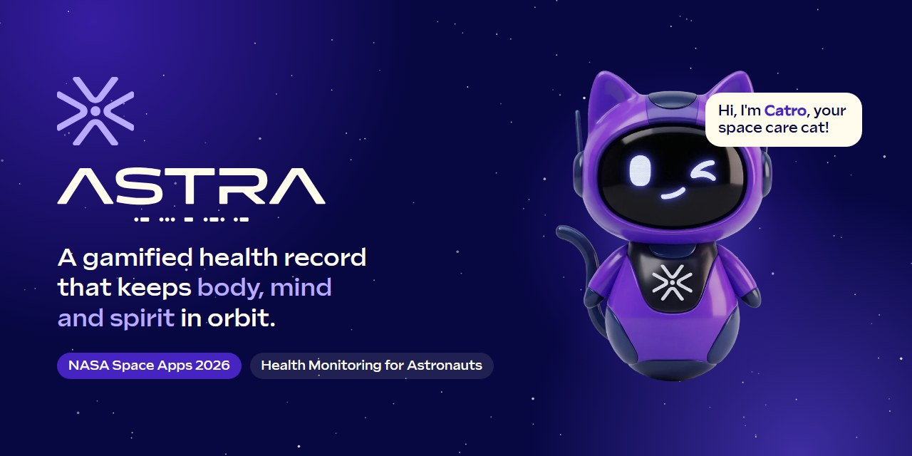
</p>

<p align="center">
  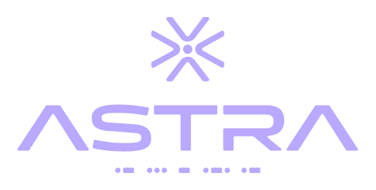
</p>

<p align="center">
  <b>A gamified health record for astronauts on space missions.</b><br>
  NASA Space Apps Challenge 2026 · <a href="https://www.spaceappschallenge.org/2026/challenges/health-monitoring-software/">Create Health Monitoring Software for Astronauts on Space Missions</a>
</p>

---

**Astra** turns crew health monitoring into a daily journey, in the spirit of Duolingo and GymRats. It brings telemetry from wearables and instruments together with the crew member's own check-ins in one electronic health record, and rewards the *habits* that keep body, mind and spirit healthy, from radiation exposure and blood oxygen to sleep, hydration and a call home.

> **Hackathon MVP.** Runs in the browser, works offline and uses **clearly labelled simulated data**. It is **not a medical device**, makes no diagnosis and is not connected to any real NASA or CSA system.

## Meet Catro

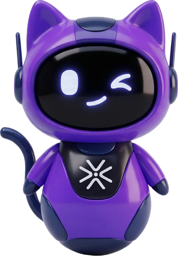

Catro is Astra's **space care cat**. Its visor is a screen whose face changes with the moment: it winks to say hi, cheers when you finish a mission, stays calm during a breathing break and dozes when the day is done. Catro describes what was logged and points to the next step or to human support. It never judges or diagnoses.

The brand uses dark blues and violet so it is easy on the eyes and avoids the stress of medical alerts. The logo's arrows point to the centre (data stays on the device) and the Morse code under the name stands for the distance from Earth.

<br clear="right">

## What it does

| | |
|---|---|
| 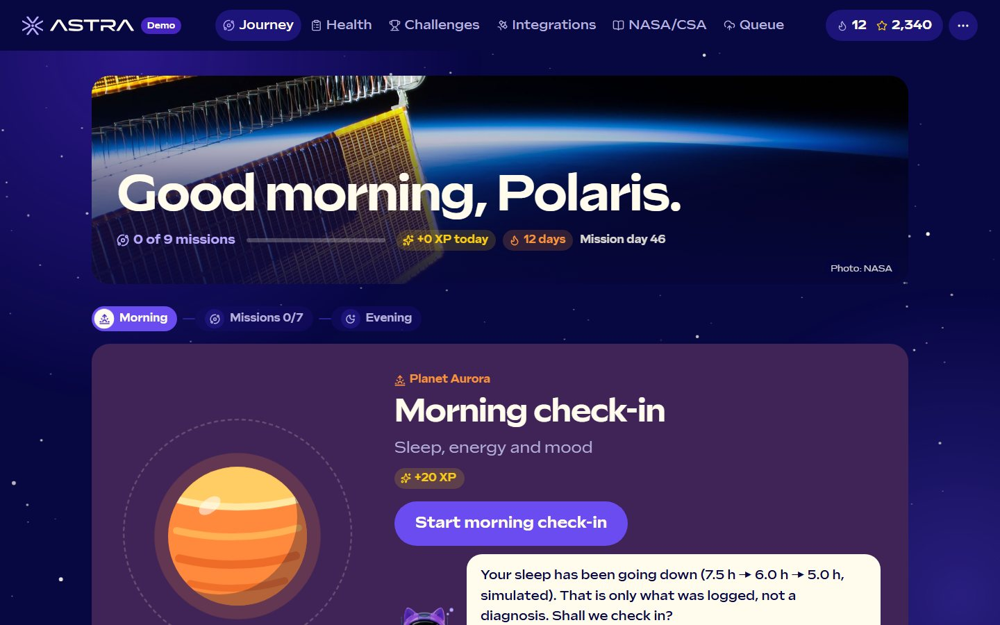 | 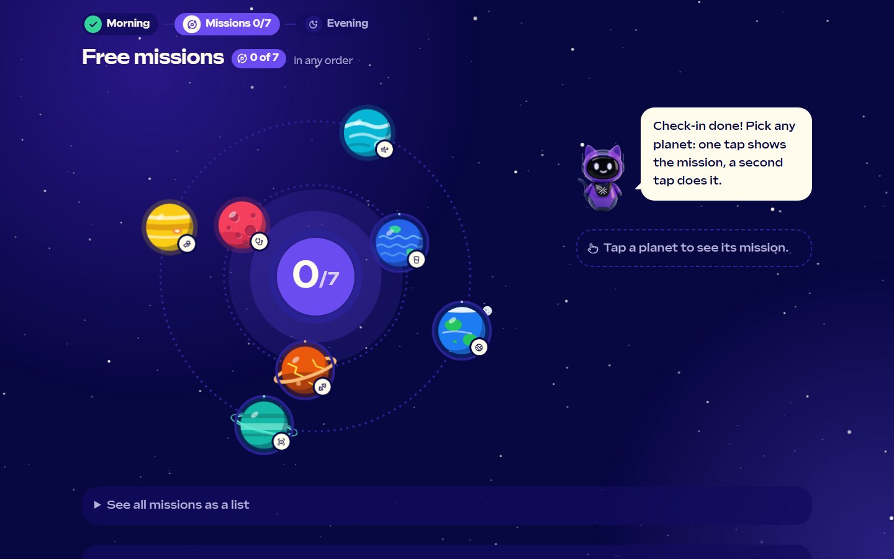 |
| **The day as a journey.** It opens with the morning check-in planet. | **A solar system of 7 free missions** in any order: tap a planet to see it, tap again to do it. The evening check-in closes the day. |
| 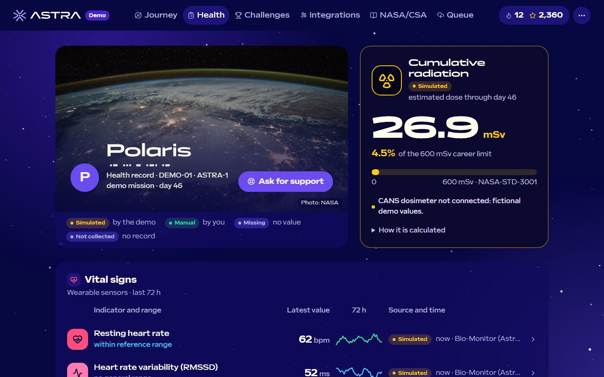 | 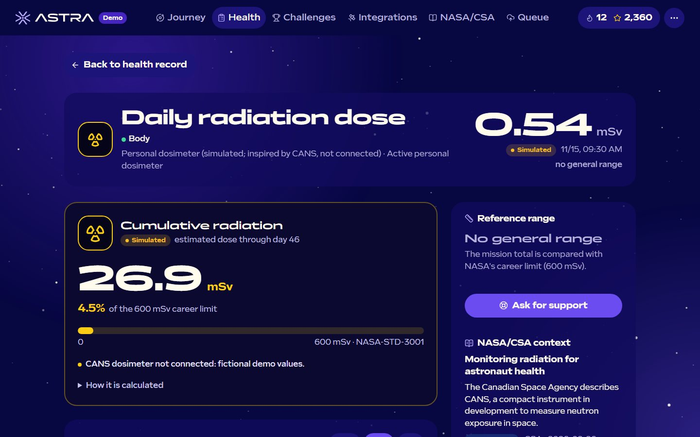 |
| **Health record.** 19 indicators, each with its origin, reference range and source; cumulative radiation against NASA's career limit. | **Explainable insight.** What changed between the first and last record, with record ids and a versioned rule, never mixing simulated and manual data. |
| 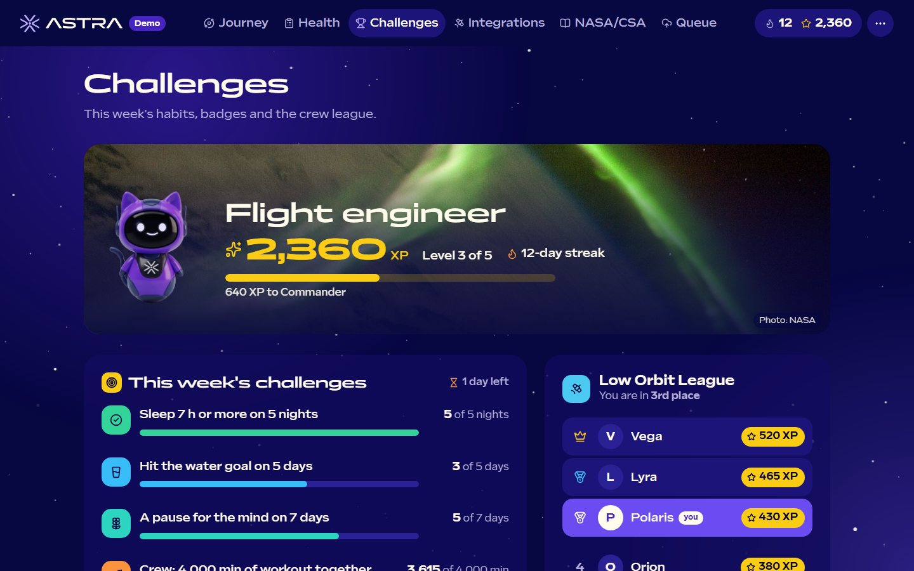 | 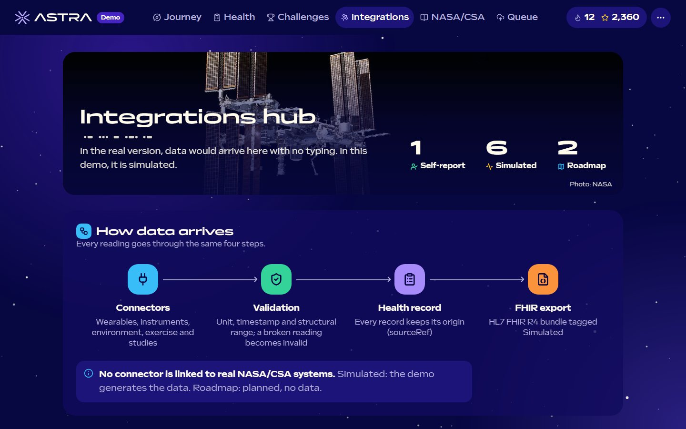 |
| **Gamification.** XP, levels, streaks, badges, weekly challenges and a crew league that shows XP only, never health data. | **Integrations hub.** Bio-Monitor, ECLSS, dosimeter, ARED, ARCHeR and CANS as simulated or roadmap connectors, plus **HL7 FHIR R4** export. |

<p align="center">
  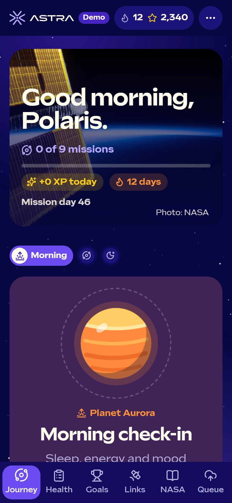
  &nbsp;&nbsp;
  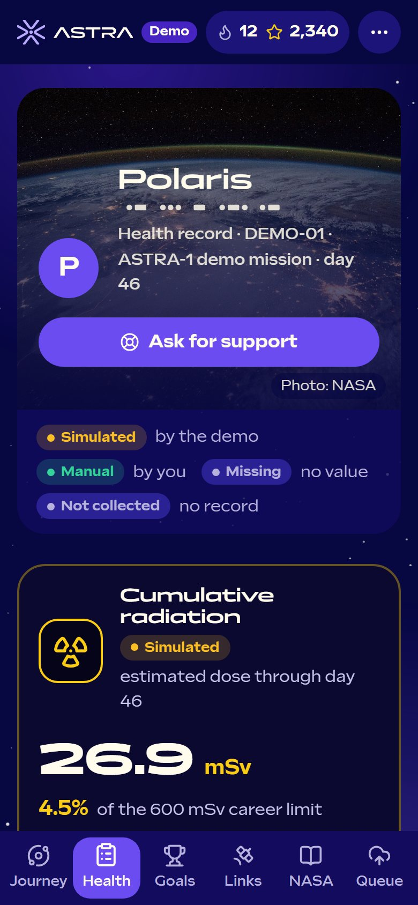
</p>

## Highlights

- **Bilingual:** English by default, Portuguese one tap away (menu "⋯").
- **Offline-first:** everything is saved in the browser (IndexedDB) and sent through a simulated queue: pending → ready → synced / failed.
- **Honest data:** every value shows where it came from (*Simulated*, *Manual*, *Missing*); a missing value is never shown as zero.
- **Body, mind and spirit:** vital signs and radiation, but also mood, stress, purpose, gratitude and time with family.
- **Built with care:** dark theme by default with a light theme, animated star field, loading screen, keyboard and screen-reader friendly, reduced-motion support, responsive down to 320 px.
- **Real imagery:** public-domain NASA photos from the ISS, credited in the app.

## Run it

```bash
npm install
npm run dev       # development server (Vite)
npm test          # 249 tests (Vitest)
npm run build     # type-check and build to dist/
npm run preview   # serve the build
```

To present, start from **Queue → Reset demo**.

**Stack:** React 19 · TypeScript 7 · Vite 8 · IndexedDB (`idb-keyval`) · `lucide-react` icons · Vitest. No backend.

## Credits

- **Team:** {{team names and roles}}
- **Visual identity, logo and Catro mascot:** IDVS by Carlos, Astra team.
- **Photos:** NASA, public domain, via Wikimedia Commons (full list in the app footer).
- **Fonts:** Panchang (Indian Type Foundry, ITF Free Font License) and Sculpin.

> ⚠️ The **Sculpin** font is licensed "Free for Personal Use" (see `src/assets/fonts/`). {{the team must confirm before publishing}}.
