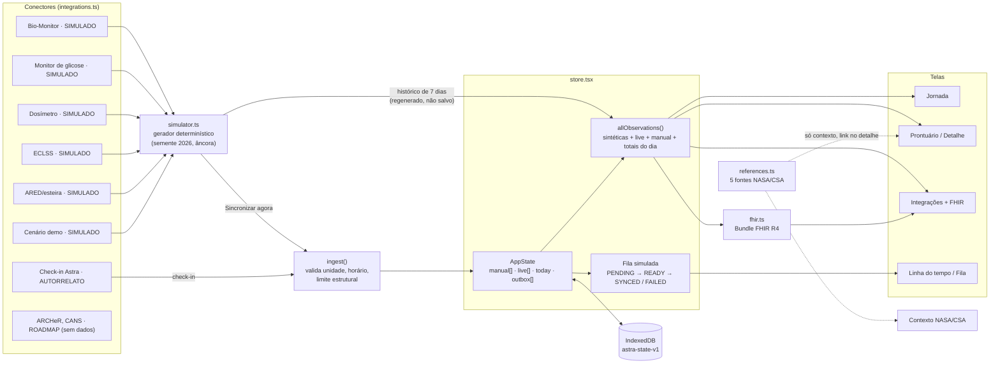

# Arquitetura

## Visão geral
O Astra é um app **100% front-end**, local-first. Não existe servidor: tudo acontece no navegador.

- **Domínio** (`src/domain/`): TypeScript puro, sem React. Contém o contrato de dados, os catálogos (indicadores, conectores, referências), as regras (tendência, faixa, ingestão, gamificação, fala do Astrido) e a exportação FHIR. É a parte testada.
- **Estado** (`src/store.tsx`): um `useReducer` dentro de um Context do React. Persiste no **IndexedDB** (via `idb-keyval`) e simula o enlace com a Terra e a fila de envio.
- **Interface** (`src/components/`, `src/screens/`, `src/App.tsx`): telas em React 19, rotas por hash, gráficos em SVG próprio.

Duas trilhas ficam separadas, como pede a base (§12):
1. **Registros pessoais**: observações simuladas, leituras de conectores e check-ins.
2. **Biblioteca de evidências NASA/CSA** (`references.ts`): só contexto citável. Nunca preenche campo de saúde nem vira limiar.

Elas só se encontram na tela de detalhe do indicador, pelo campo `referenceIds` do catálogo.

## Diagrama das camadas



## Estrutura de pastas

```
nasa2026/
├── index.html                ← página única, lang pt-BR, ícone do Astrido
├── public/astrido.svg        ← favicon
├── package.json              ← scripts dev, build, preview, test
├── vite.config.ts            ← plugin React + Vitest em ambiente node
├── tsconfig.json             ← strict, noEmit (o Vite gera o bundle)
├── specs/                    ← método spec-driven (base, requisitos, design, tarefas)
├── docs/                     ← esta documentação
└── src/
    ├── main.tsx              ← monta <StoreProvider><App/></StoreProvider>
    ├── App.tsx               ← faixa DEMO, TopBar, roteador por hash, BottomNav, diálogos globais
    ├── styles.css            ← tokens de design e classes compartilhadas
    ├── store.tsx             ← AppState, reducer, persistência, fila simulada, índices por indicador
    ├── store.test.ts
    ├── domain/               ← TypeScript puro (sem React)
    │   ├── types.ts          contrato: Observation, SyncEvent, origens e estados
    │   ├── indicators.ts     19 indicadores, faixas com fonte, formatValue, rangePosition
    │   ├── references.ts     5 fontes NASA/CSA + filtro por hazard
    │   ├── trend.ts          describeTrend, trendForLatestOrigin, withinWindow
    │   ├── simulator.ts      dados simulados (7 dias + cenário 72 h) e leituras "ao vivo"
    │   ├── integrations.ts   9 conectores, limites estruturais, ingest()
    │   ├── fhir.ts           Observation → Bundle FHIR R4
    │   ├── gamification.ts   missões, níveis, conquistas, desafios, liga
    │   ├── astrido.ts        humor + fala do Astrido
    │   └── *.test.ts         testes Vitest
    ├── components/
    │   ├── Astrido.tsx       mascote em SVG (5 humores) + SpeechBubble
    │   ├── Chart.tsx         gráfico de linha em SVG com faixa sombreada
    │   ├── ui.tsx            selos de origem, KindTag, Ring, Bar, Sparkline, RangeHint, datas
    │   ├── TopBar.tsx        abas, ofensiva, XP, nível, botão do enlace; BottomNav no celular
    │   ├── Shell.tsx         useRoute (hash), go(), contexto para abrir o apoio
    │   ├── SupportDialog.tsx pedido de apoio com confirmação (diálogo acessível)
    │   └── Celebration.tsx   toast "+XP" quando uma missão conclui
    └── screens/              uma tela por arquivo, cada uma com seu .css
        Jornada · Prontuario · Indicador · CheckIn · Respirar · Gratidao
        Desafios · Contexto · Integracoes · LinhaDoTempo
```

## Fluxo de dados de um check-in, de ponta a ponta

1. **Tela** (`screens/CheckIn.tsx`, rota `#/checkin`): o tripulante preenche sono (passos de 0,5 h), energia (0–10), humor (0–10, pode pular) e "Você se sente diferente do habitual?". Campo pulado fica `null`.
2. **Revisão**: a tela mostra uma tabela com valor, unidade, horário e origem (`MANUAL` ou `AUSENTE`) antes de salvar.
3. **Ação**: ao salvar, despacha `{ type: "checkIn", input: { values, label, missionId: "checkin" } }`.
4. **Reducer** (`store.tsx`):
   - cria um `SyncEvent` `check_in` em estado `pending`, com `eventId` e `idempotencyKey`;
   - passa **cada campo** por `ingest()` com o conector `astra-checkin` → vira uma `Observation` com `origin: "manual"`, `sourceRef: "astra-checkin"` e `qualityState` `valid`, `missing` (valor `null`) ou `invalid`;
   - guarda as observações em `manual[]` e liga cada uma ao evento em `obsEvent`;
   - chama `finishMission("checkin")`: soma 20 XP (só na primeira vez no dia), avalia a ofensiva, atualiza conquistas e cria um segundo evento `mission_done`.
5. **Persistência**: um `useEffect` grava o `AppState` inteiro no IndexedDB (`astra-state-v1`) a cada mudança. Isso acontece **antes** de qualquer "envio".
6. **Fila simulada**: se o enlace está ligado, a cada 0,9 s o reducer avança `pending → ready → synced` (ou `failed`, se "simular falha" estiver ligado). Offline, nada avança.
7. **Leitura**: `allObservations()` junta sintéticas + `live` + `manual` (com `syncState` copiado do evento da fila) + totais do dia. O `store` indexa por indicador e ordena por horário.
8. **Telas consomem**: o cartão do Prontuário mostra o novo valor com selo `MANUAL`; o Detalhe aplica a regra anti-mistura; a Linha do tempo mostra o evento na fila; a Jornada marca a missão e mostra a comemoração com o Astrido.

## Decisões técnicas e por quê

| Decisão | Por quê |
|---|---|
| **Local-first, sem backend** | A base pede funcionamento offline e persistência antes de qualquer envio (§26). Sem servidor, não há dado trafegando nem credencial para gerenciar num MVP de hackathon. O backend (Node + PostgreSQL) é fase 3 do roadmap. |
| **IndexedDB via `idb-keyval`** | API simples de chave-valor, assíncrona, sem esquema. O estado inteiro cabe numa chave. Se o IndexedDB falhar, o app continua em memória e mostra o aviso "Armazenamento local indisponível". |
| **Gráficos e mascote em SVG próprio** | Nenhuma biblioteca de gráfico: menos peso, funciona offline e dá controle total para pintar a faixa de referência em tom neutro (nada de zona vermelha). A fonte Nunito também é embutida (`@fontsource-variable/nunito`). |
| **Simulador determinístico regenerado da âncora** | O histórico simulado **não é salvo**: é recalculado a partir de `anchor` com semente fixa (2026). A demo conta sempre a mesma história e o IndexedDB guarda só o que o usuário fez. Se o estado salvo tem âncora com mais de 1 h, a âncora é renovada para os dados não ficarem "velhos". |
| **Regra anti-mistura** | A base bloqueia tendência que mistura simulado com real (`mixed_origins_blocked`). Na prática, o Detalhe usa `trendForLatestOrigin`: compara só a origem do registro mais recente e diz quantos ficaram de fora, em vez de esconder tudo. |
| **Camada de ingestão única** | Tanto check-ins quanto leituras de conectores passam por `ingest()`. Leitura com unidade errada, horário inválido/futuro ou valor fora do limite estrutural vira `invalid` e não entra na tendência nem no FHIR. |
| **Domínio sem React** | Regras testáveis com Vitest em ambiente `node`, sem DOM. A UI só chama funções puras. |
| **Rotas por hash** | Sem configuração de servidor: `#/prontuario/glucose` funciona em qualquer hospedagem estática e no `vite preview`. |
| **CSS por tela + tokens globais** | Cada tela tem seu `.css`; `styles.css` só tem tokens e classes compartilhadas. Permitiu que vários agentes trabalhassem em paralelo sem conflito. |
| **Sem IA generativa** | Toda fala e todo cálculo são determinísticos e reproduzíveis. Nenhum modelo decide nada sobre saúde. |
